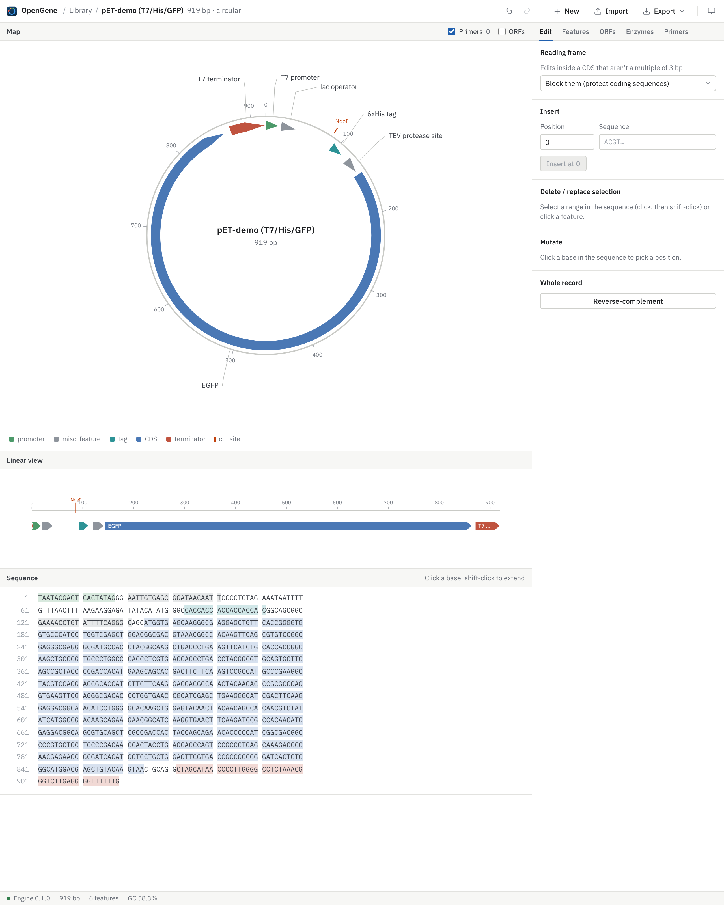

# OpenGene

An open-source, AI-native plasmid editor — a free alternative to SnapGene.

This repository implements **Phase 1** of the OpenBioMap specification: a
deterministic sequence-editing engine with a REST API, and a React/TypeScript
canvas that renders synchronized circular and linear plasmid maps.

> **Architecture principle — the Sequence Invariant.** All biological sequence
> manipulation is handled by deterministic Python backend services and validated
> through Biopython. The UI (and, in Phase 2, any AI layer) only ever issues
> structured operations against that engine; no component edits raw sequence
> strings directly.



## Repository layout

```
backend/    FastAPI + Biopython engine, feature library, tests   (see backend/README.md)
frontend/   React 18 + TypeScript, custom-SVG maps               (see frontend/README.md)
desktop/    Electron app — double-click install for labs         (see desktop/README.md)
```

## For non-technical lab users (desktop app)

Scientists don't need Python, Node, or a terminal. The `desktop/` package builds
a signed-ready **macOS `.dmg`** and **Windows `.exe`** that bundle the engine and
UI into one double-click app; plasmids persist locally in SQLite. Installers are
produced by GitHub Actions (`.github/workflows/desktop-build.yml`) — push a `v*`
tag and download the artifacts. End-user steps are in [docs/INSTALL.md](docs/INSTALL.md);
build/signing details in [desktop/README.md](desktop/README.md).

## Quick start

```bash
# Backend
cd backend
python -m venv .venv && . .venv/bin/activate
pip install -e ".[dev]"
pytest -q                              # run the test suite
uvicorn opengene.api:app --port 8000   # API + /docs

# Frontend (new terminal)
cd frontend
npm install
npm run dev                            # http://localhost:5173
```

Open the app: the library starts with eight sample plasmids (pUC19, pBR322,
pEGFP-N1, pGEX-4T-1 and others). They live in
[`backend/opengene/data/samples/`](backend/opengene/data/samples/), which also
makes them handy test files to import.

## How to use

The window has three parts: the **maps** on the left (circular map, linear view,
and the colored sequence), the **inspector** tabs on the right (Edit, Features,
ORFs, Enzymes, Primers), and a **status bar** along the bottom (engine status,
length, feature count, GC%, and the current selection). Selecting anything —
a feature, a base, a range — highlights it in all three views at once.

- **Open a plasmid.** On the Library screen, click any row. The library starts
  with the bundled samples; **Add samples** restores any you've deleted,
  **Import…** opens your own `.gb` / `.fasta` / `.embl` / `.dna` file, and
  **New sequence** starts one from pasted DNA.
- **Select a region.** Click a feature on either map, or click a base in the
  sequence and shift-click another to extend. The status bar shows the span and
  its length.
- **Edit** (Edit tab) — insert, delete, replace, or mutate the selection, or
  reverse-complement the whole record. Feature coordinates move with your edit,
  and **⌘/Ctrl-Z** undoes it. The *Reading frame* control decides what happens
  to a CDS when an edit isn't a multiple of 3 bp.
- **Annotate** (Features tab) — **Auto-annotate** labels known parts from the
  feature library; you can also add or edit features by hand.
- **Cut sites** (Enzymes tab) — type enzymes, **Map & digest** to draw the sites
  and list fragment sizes, or **Unique cutters** to find single cutters.
- **Primers** (Primers tab) — select a region and **Design primers** for a pair
  flanking it, or paste an oligo into **Analyze** for Tm / GC / hairpin / dimer
  checks. [docs/sample-primers.md](docs/sample-primers.md) has a ready-made pair
  for each sample.
- **Export** (title bar) — download the record as GenBank or FASTA.

### A five-minute walkthrough (pUC19)

1. **Open it.** Click **pUC19** in the library. The circular map draws the 2,686
   bp vector; **Auto-annotate** has already labelled the ColE1/pUC origin, AmpR
   (bla), and the lac promoter and operator. The status bar reads its length and
   GC%.
2. **Explore a feature.** Click the blue **AmpR (bla)** arrow. It highlights on
   the circular map, in the linear view, and in the sequence, and the status bar
   shows its span (1625–2486, 861 bp).
3. **Map a restriction site.** Open **Enzymes**, keep the default enzyme list,
   and click **Map & digest**. EcoRI, HindIII, BamHI and others appear as marks
   around the backbone with their fragment sizes listed. **Unique cutters**
   filters to enzymes that cut exactly once — the ones useful for linearizing.
4. **Design primers.** With **AmpR (bla)** still selected, open **Primers** and
   click **Design primers for 1625–2486**. A forward/reverse pair appears with
   Tm and GC, and (if the Primers overlay is on) as arrows on the maps. Paste
   either one into **Analyze an oligo** to see its full report. These match the
   pUC19 row in [docs/sample-primers.md](docs/sample-primers.md).
5. **Make an edit, then undo it.** In **Edit**, type a few bases into *Insert*
   and insert them at a position; watch the map and sequence update and the
   length change. Press **⌘/Ctrl-Z** to undo.
6. **Export.** Use **Export → GenBank** in the title bar to download the
   annotated plasmid for use in other software.

## What's implemented (Phase 1)

- **File I/O** — import GenBank, FASTA, EMBL, SnapGene `.dna`; export GenBank/FASTA/EMBL
- **Visualization** — synchronized circular + linear maps and a colored sequence
  view, with directional feature arrows, restriction cut sites, and
  origin-wrapping features
- **Editing** — insert / delete / mutate / replace / reverse-complement, with
  correct feature-coordinate maintenance and circular boundary wrap-around
- **Undo / redo** — every edit is reversible (Ctrl/Cmd+Z, Ctrl/Cmd+Shift+Z);
  the full record state steps back and forth, and a rejected edit is a no-op
- **Feature editing** — edit an existing feature's name, type, strand,
  coordinates, and color inline (not just add / delete)
- **Map overlays** — toggle designed primers and 6-frame ORFs as directional
  tracks on both the circular and linear maps
- **ORF detection** across all 6 reading frames (including origin-crossing ORFs)
- **Restriction** — cut-site mapping, digest fragment sizes, unique cutters (NEB set)
- **Primers** — Tm / GC / hairpin / dimer analysis and PCR primer-pair design (primer3)
- **Auto-annotation** — pure-Python seed-and-extend matching against a bundled
  feature library (promoters, terminators, tags, resistance genes, fluorescent
  proteins, and replication origins — ColE1/pUC, f1, SV40, p15A) on both strands
  and across the origin;
  tolerates substitutions and indels, finds partial parts, and reports identity
  and coverage per hit

## Design decisions

These were chosen for this build (see the specification for the full menu):

| Area | Choice |
|------|--------|
| Map rendering | Custom SVG components (not OpenVectorEditor) for full control of sync + wrap-around |
| Feature matching | Pure-Python library matching; optional NCBI BLAST+ hook when `blastn` is on `PATH` |
| `.dna` files | Import-only (Biopython has no SnapGene writer); export via GenBank |

## Not in this phase

Phase 2 — the AI intent-parsing / function-calling layer (`insert_sequence_at_feature`,
`simulate_gibson_assembly`, etc.) — is intentionally out of scope here. The REST
API in `backend/` is exactly the deterministic tool surface those agents will call,
so the AI layer can be added without touching the engine. The intended wiring is a
LangChain tool layer with every LLM output passing through the engine's validation
before any state mutation.

## License

MIT
